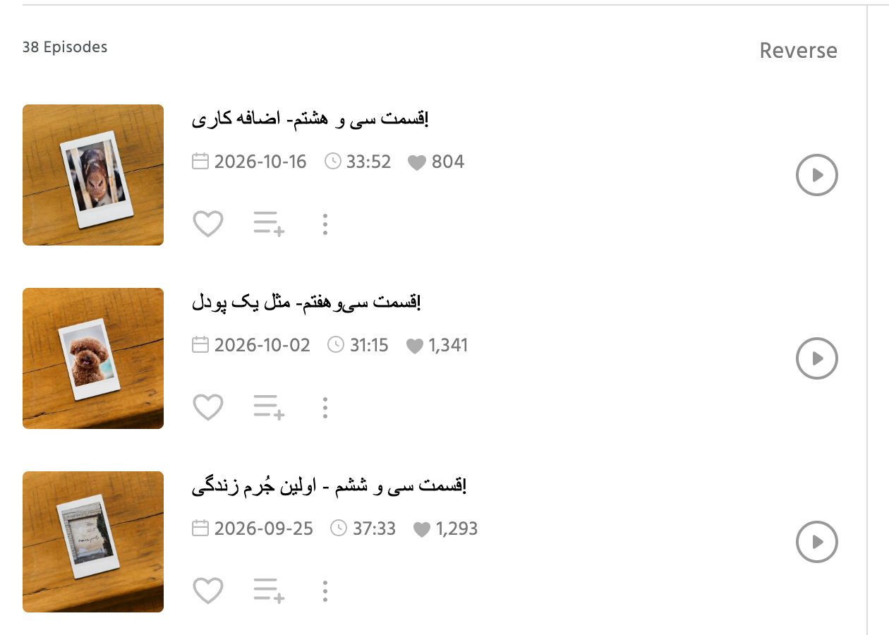
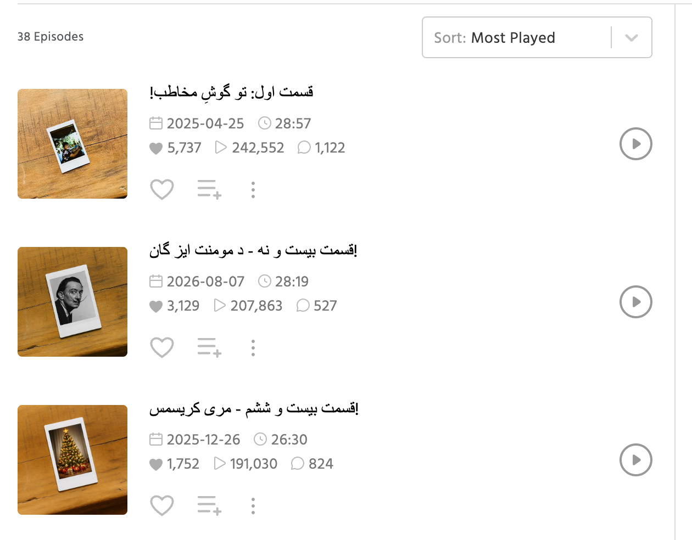
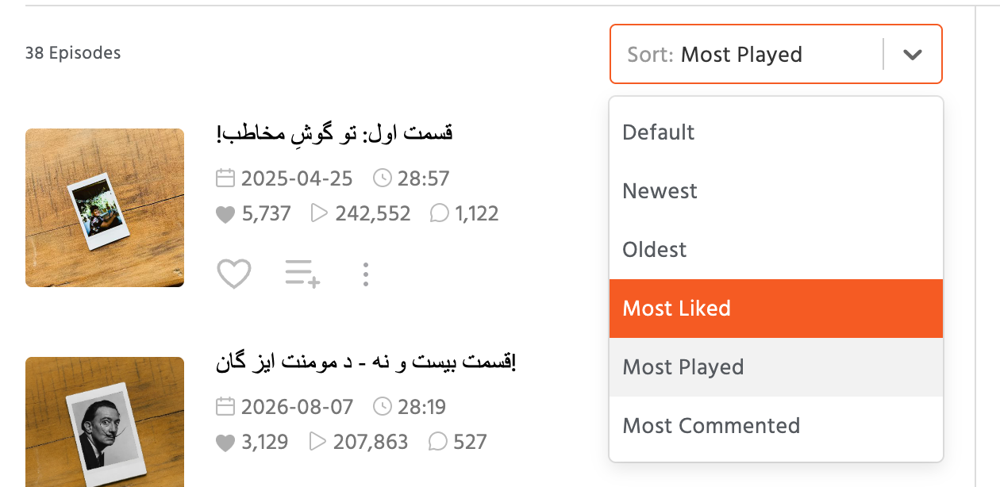

# Castbox Sorter

  

A simple Chrome Extension that adds powerful sorting options (by likes, plays, comments) to Castbox.fm channel pages.

---

### 💡 The Problem

By default, Castbox.fm channel pages **only** sort episodes by "Newest". If a podcast channel has hundreds of episodes, it's impossible for users to find the most popular, highest-rated, or most-played episodes.

### ✨ The Solution

This extension adds a **Sort** dropdown to the episode list of any Castbox.fm channel page (in place of the "Reverse" button). It re-sorts the *entire* episode list (not just the ones on the page) by:

* **Default** (the channel's own order)
* **Newest** / **Oldest**
* **Most Liked**
* **Most Played**
* **Most Commented**

The sorted list is rendered by Castbox itself, so everything works exactly as on the original page: playing episodes, the like button, "add to playlist", the ⋮ menu and infinite scroll. Each episode also shows its play and comment counts next to the likes.

This helps you quickly discover the "hidden gems" and best episodes of any podcast you follow.

### 📸 Screenshots

| Before (Default Castbox) | After (Sorted by Most Played) |
| :---: | :---: |
|  |  |

  

### 🚀 How to Install (Manually)

Since this extension is not yet on the Chrome Web Store, you can easily install it manually in 1 minute.

1.  **Download:**
    * Click the green **`< > Code`** button at the top of this GitHub page.
    * Select **Download ZIP**.
    * Unzip the downloaded file (you will get a folder named `castbox-sorter-main` or similar).

    > Requires Google Chrome 111 or newer.

2.  **Open Chrome Extensions:**
    * Open your Google Chrome browser.
    * Type `chrome://extensions` in the address bar and press Enter.

3.  **Enable Developer Mode:**
    * In the top-right corner of the Extensions page, turn on the **Developer mode** toggle.

4.  **Load the Extension:**
    * Click the **Load unpacked** button that just appeared.
    * A file dialog will open. Select the **entire folder** you unzipped in Step 1 (the one that contains `manifest.json`).

That's it! The extension is now active. Go to any Castbox.fm channel page, and you will see the new **Sort** dropdown above the episode list.

**Updating:** download the new version, replace the old folder, then click the reload (↻) button on the extension's card in `chrome://extensions` and refresh the Castbox page.

### 🔒 Privacy Policy

This extension is 100% safe and respects your privacy.

* It does **not** collect, store, or transmit any personal data.
* It does **not** read your Castbox login or account data.
* It does **not** track your browsing activity.
* It only reads public episode data (likes, plays, comments, dates) from Castbox's public API. Sorting happens locally in your browser.

### 📜 License

This project is licensed under the **MIT License**. See the [LICENSE](LICENSE) file for details.
